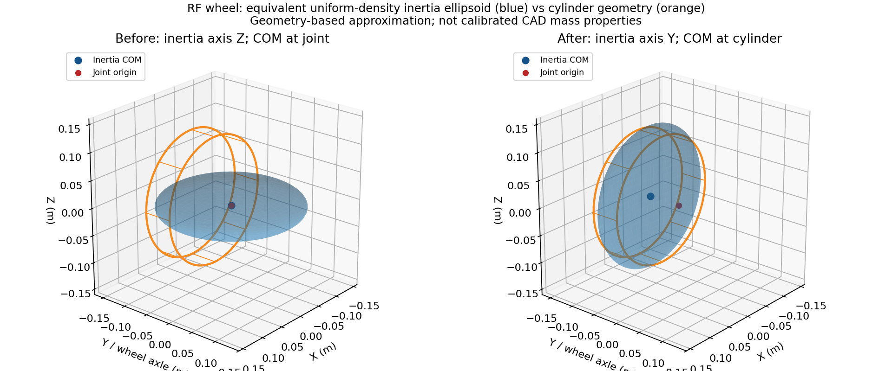

# Lego2 惯量核查与第一批修复

资料位置与关联见[统一资料索引](README.md)；当前交接入口见[HANDOFF.md](HANDOFF.md)。

历史核查日期：2026-10-27（Asia/Shanghai）。当时本地静态/CPU验证通过。
**后续状态更新**：2026-10-29用户确认资产纠偏完成且远程已同步；不应再因本篇旧记录
重复要求同一资产修复或同步。最新状态见[CURRENT_STATUS](CURRENT_STATUS.md)。
实物CAD精确标定与训练/回放版本对应仍未由该确认自动证明；本篇保留原审计依据。

## 结论与证据范围

用户在 Robot Viewer 发现轮子惯量方向与轮面相差约 90°，并怀疑腿部惯量。
本次检查了本地 URDF、MJCF、机器人加载入口、碰撞几何和 STL，并与只读远程
快照比对。修复前 URDF/MJCF 与 `20261015_204549` 快照逐字节一致，问题不是
最近高台奖励修改时引入的。

训练入口 `lego2_constants.py` 的 `LEGO2_XML` 和 `get_spec()` 加载
`xmls/lego2.xml`，不在训练时动态转换 URDF。因此只改 URDF 不能修正训练动力学。
本次在两种格式中同步修复，且未改奖励、PPO、动作、地形、关节、碰撞尺寸或质量。
由于该资产被 Rough/Flat/Platform-Climb 共用，三个任务的动力学都会受影响。

惯量可视化通常是等效惯量盒/椭球，并非真实几何。大腿包含电机、连杆和偏置，
不必轴对称；非零惯性积也不必然错误。不能仅凭外观把所有惯性积设为零。

## 轮子：已确认的模型内部不一致及修复

四个轮子的旋转关节轴为局部 `0 1 0`。圆柱几何由局部 Z 轴绕 X 轴旋转 90°，
圆柱轴线与局部 Y 平行。原惯量没有相应旋转，且惯性质心位于关节原点。

原数值恰好是质量 `m=1.6 kg`、半径 `r=0.115 m`、全宽 `L=0.052 m`
的均匀实心圆柱公式：

```text
I_axis = m*r²/2 = 0.01058 kg·m²
I_transverse = m*(3*r² + L²)/12 = 0.005650533333333333 kg·m²
```

| 项目 | 修复前 | 修复后（沿用均匀圆柱近似） |
| --- | --- | --- |
| Ixx | 0.005650533333333333 | 0.005650533333333333 |
| Iyy | 0.005650533333333333 | 0.01058 |
| Izz | 0.01058 | 0.005650533333333333 |
| RF/RH 质心 | (0, 0, 0) | (0, -0.062, 0) |
| LF/LH 质心 | (0, 0, 0) | (0, 0.062, 0) |

惯量围绕新质心给出，所以保持上述中心惯量，不向该张量再加平行轴项；
MuJoCo 会在动力学装配中处理质心相对关节的位移。
62 mm 是模型圆柱的中心偏移；本次据此使原有近似自洽，**不是实物质心测量值**。
若 FOOT 包含偏置电机/轮毂等非均匀组件，仍需按完整组件 CAD 数据重新标定。

RF 的 MJCF 核心修改：

```xml
<inertial pos="0 -0.062 0" mass="1.6"
  fullinertia="0.005650533333333333 0.01058 0.005650533333333333 0 0 0"/>
```

URDF 对应修改为：

```xml
<inertial>
  <origin rpy="0 0 0" xyz="0 -0.062 0"/>
  <mass value="1.6"/>
  <inertia ixx="0.005650533333333333" ixy="0" ixz="0"
    iyy="0.0105800000000000" iyz="0" izz="0.005650533333333333"/>
</inertial>
```

惯量已写在 link/body 坐标系中，所以惯性坐标系保持零旋转，避免再旋转一次。

## 髋部：同类圆柱近似轴向问题

四个 hip 原数值也恰好符合均匀圆柱，`m=1.25 kg`、`r=0.05 m`、全长 `0.075 m`。
碰撞圆柱轴线沿 Y，但原惯量的轴向分量在 Z。第一批同步改为：

```text
Ixx=0.0013671875, Iyy=0.0015625, Izz=0.0013671875 kg·m²
```

髋部原质心位置未改。髋部质心与碰撞圆柱中心本身不重合，真实髋部质量分布仍待
CAD 确认；本次仅将原来的圆柱近似惯量方向对齐，不宣称它已是精确实物模型。

## 腿部和其他待确认问题（本次未改）

1. 四条 thigh 使用相同完整惯量张量；四条 calf 也分别使用相同张量。
   对应 link/body 的惯性质心均为 `(0,0,0)`，即关节原点。
2. STL 大致呈左右/前后镜像，但所有腿的非零惯性积符号也相同。
   镜像质量分布原则上需要 `I'=S I Sᵀ`，不能无条件复制同一矩阵。
   目前不能确认哪一条腿原始数值可靠，也不能仅凭几何证明真实内部组件镜像，
   因此本次不凭猜测翻转符号或移动腿部质心。
3. 本地 trimesh 检查的四个 thigh 和抽查的轮子 STL 均为非封闭网格。
   STL 也没有电机/材料密度信息，不能直接用均匀 STL 体积积分替代实物惯量。
4. 正质量刚体的现有 thigh/calf 张量满足正定与惯量三角不等式。
   这仅说明数学可用，不能证明其物理值、参考点或坐标系正确。
5. URDF 的 `Lidar_Fixed_Link` 为 `2 kg`、零惯量；`Lidar_part_Link` 为零质量/零惯量。
   MJCF 则将雷达作为 base 的几何，没有单独雷达刚体。
   URDF 各 link 质量合计 `51.176 kg`，MJCF 为 `49.176 kg`。
   base 质量是否已包含雷达、转换时是否遗漏：**待确认**，本次未改。

需要用户提供完整 thigh/calf/hip/FOOT 组件的 CAD 质量属性：每个 link 的质量、
质心 XYZ、关于质心的六个惯量分量、这些分量所用坐标系及其相对 link 的变换、
单位（m/mm、kg、kg·m²/kg·mm²）。明确 CAD 是否含电机/减速器，不能只给
STL 外观。四个 link 数据或可验证的镜像关系均可。

## 变更、备份与验证

修复文件：

```text
src/mjlab/asset_zoo/robots/lego2/urdf/urdf_legowheel2.urdf
src/mjlab/asset_zoo/robots/lego2/xmls/lego2.xml
```

新增 CPU 验证工具：`scripts/tools/check_lego2_inertia.py`。
URDF 的 CRLF 换行保留，避免整个文件被格式化。原文件完整备份及 SHA-256 在：

```text
docs/codex/backups/20261027_lego2_inertia_before_v1/
```

备份按源码相对路径保存；恢复时仅将该目录中两个资产复制回相同相对路径。
未修改只读远程快照、依赖锁文件或已有训练结果。

已执行：

- `uv run --no-sync python scripts/tools/check_lego2_inertia.py`：8 个圆柱张量、
  URDF/MJCF 一致性、4 个轮子质心/旋转轴检查通过。
- `PYTEST_DISABLE_PLUGIN_AUTOLOAD=1 FORCE_CPU=1 uv run --no-sync pytest -q
  tests/test_asset_zoo.py -k Lego2`：1 passed，训练资产 Entity 编译通过。
  首次普通 pytest 被环境中的 ROS launch_testing 插件和缺失 lark 阻断，
  已通过仅对本次命令禁用第三方插件自动加载排除干扰，未修改 ROS 或依赖。
- 新脚本 Ruff 格式和 lint 通过；三个 Lego2 任务注册仍可加载。
- 新脚本 Pyright：0 errors，0 warnings。校验器对原始快照会按预期失败，
  对修正后资产通过，避免只做“能加载”的弱检查。
- 与备份比较：总质量 `49.176 kg`、`nq=19`、`nv=18`、关节和全部碰撞几何不变。
- 20 个配置的正向运动学对照一致，质量矩阵正定，正向动力学有限。
  非 hip/FOOT 的惯性质心和张量保持不变。

没有运行 GPU 训练、MuJoCo Warp 动态接触验证或实物验证，因此不能断言已解决
登顶失败或EPA warning。原审计时点的远程同步待办已由用户后续确认完成；
新动力学下的具体试训及模型版本对应以[实验记录](EXPERIMENT_LOG.md)为准。

修复后的 SHA-256（用于与远程文件核对）：

```text
9502149ed6a95a7d7e5453c1d5a8b085ddd7afbbf4c93de7d0780b42a81f1443  xmls/lego2.xml
6c05b612f365d1740cffd3892817b86ada05f6821e414d11ef07a60debe8baef  urdf/urdf_legowheel2.urdf
```

图中蓝色为等效惯量椭球，橙色为当前圆柱外形；椭球边界不要求贴合圆柱边界。



## 后续实验边界

本轮只改变共享资产动力学；保留当前高台奖励配置作为对照。
先同步资产和 CPU 校验工具，远程校验后做单环境回放/小规模训练；保留旧 checkpoint，
新实验使用新 run 名称并记录资产版本。旧 checkpoint 可供旧动力学对照，不能把
修复前后结果混在同一条实验曲线中。完整长训应等待资产质量属性进一步确认。

## 参考

- [MuJoCo XML inertial 说明](https://mujoco.readthedocs.io/en/latest/XMLreference.html#body-inertial)：
  fullinertia 按 body 方向给出，编译时转换成质心主轴张量。
- [MuJoCo 模型坐标系与等效惯量显示](https://mujoco.readthedocs.io/en/latest/overview.html)：
  惯性坐标系位于质心并沿惯性主轴；惯量显示不是物体外形网格。
